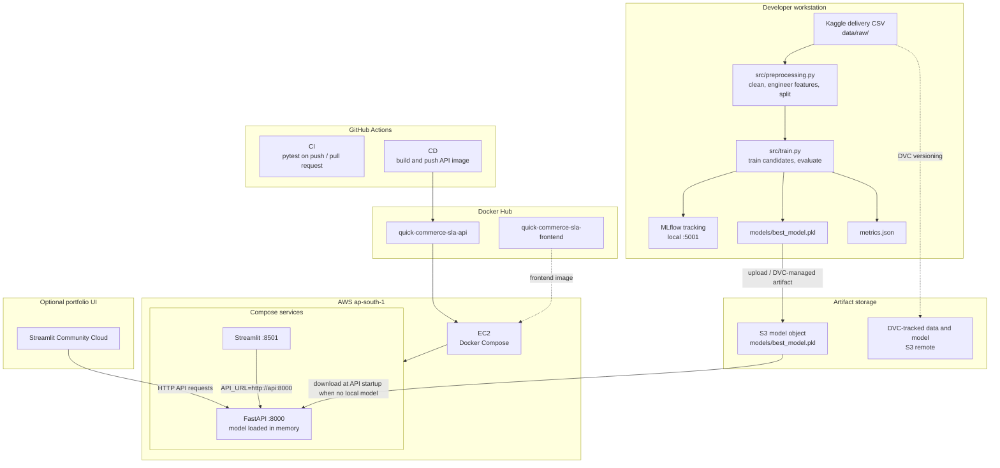

# System Architecture — Quick-Commerce SLA Risk MLOps Platform

This document describes the end-to-end path from delivery data and model
training to containerized inference.

## High-level architecture



The CI and CD workflows are separate. CI runs tests for pushes and pull
requests to `dev` and `main`; CD runs on pushes to `main` (or manual dispatch)
and publishes the API image. Deploying updated images to EC2 is a separate
Compose operation. The frontend image is not built by the current CD workflow.

## Lifecycle

| Stage | Component | Responsibility |
| --- | --- | --- |
| Ingest | Kaggle CSV in `data/raw/` | Provide delivery features and delivery time |
| Version | DVC | Track data and model artifacts without storing large binaries in Git |
| Transform | `src/preprocessing.py` | Clean fields, derive `distance_km`, and create the SLA target |
| Train | `src/train.py` and MLflow | Train five candidate classifiers, compare metrics, and save the top ROC-AUC model |
| Store | S3 | Keep the production model at `models/best_model.pkl` |
| Package | Dockerfiles | Build the API and frontend runtime images |
| Qualify | GitHub Actions CI | Run pytest on supported pushes and pull requests |
| Publish | GitHub Actions CD | Build and push the API image for `linux/amd64` to Docker Hub |
| Serve | EC2 and Docker Compose | Run the API and frontend services |
| Observe | `/health`, logs, and UI health tab | Report API and model readiness |

## Training and feature pipeline

1. The raw dataset is read from `data/raw/quick_commerce.csv`.
2. Preprocessing cleans the delivery-time and rider fields, imputes selected
   missing values, and computes the restaurant-to-customer Haversine distance.
3. `will_breach_sla` is set to `1` when delivery time is greater than 30
   minutes, otherwise `0`. The processed data is split into train and test
   files under `data/processed/`.
4. Training evaluates Logistic Regression, Random Forest, XGBoost, tuned
   XGBoost, and LightGBM pipelines. Runs and metrics are logged to local
   MLflow.
5. The candidate with the highest ROC-AUC is written to
   `models/best_model.pkl`; the metrics summary is written to `metrics.json`.

The API request schema contains the engineered `distance_km` feature. It does
not calculate distance from coordinates at inference time.

## Production inference path

```text
Client / Streamlit UI
        │
        ├── GET  /health
        └── POST /predict or /predict/batch
                  │
                  ▼
          FastAPI service :8000
          model cached in memory
                  │
                  └── boto3 download at startup when no local model exists
                              │
                              ▼
                  S3 models/best_model.pkl
```

`api/model_loader.py` first checks for a local model file. If it is absent, the
API downloads the model from S3 using the configured bucket, key, and AWS
region, then caches the loaded model in the process. The API image does not
include the model binary.

## EC2 network and process layout

```text
                         Internet
                      │            │
                  :8000            :8501
                      ▼            ▼
                ┌──────────┐   ┌────────────┐
                │ FastAPI  │◄──│ Streamlit  │
                │ api:8000 │   │ frontend   │
                └────┬─────┘   └────────────┘
                     │
                     │ AWS credentials / IAM permissions
                     ▼
                    S3 model
```

Docker Compose exposes the API on port `8000` and the frontend on port `8501`.
The frontend reaches the API over the Compose network using
`API_URL=http://api:8000`. The frontend service waits for the API health check
to pass.

## CI/CD and deployment

```text
git push / pull request to dev or main
                 │
                 ▼
       CI: Python 3.11 + pytest

git push to main (or workflow dispatch)
                 │
                 ▼
       CD: Docker Buildx, linux/amd64
                 │
                 ▼
       Docker Hub API image
                 │
                 ▼
       EC2: Compose pull / up
```

CI and CD are implemented as separate GitHub Actions workflows. CI runs tests
on pushes and pull requests to `dev` and `main`. CD publishes versioned and
`latest` API image tags to Docker Hub; the current workflow does not deploy to
EC2 or publish the frontend image.

## Runtime configuration

| Setting | Purpose |
| --- | --- |
| `AWS_REGION` | AWS region used for the S3 model download; defaults to `ap-south-1` |
| `S3_BUCKET_NAME` | Model bucket; defaults to `mlops-sla-mahipune01` |
| `API_URL` | Frontend API base URL; Compose uses `http://api:8000` |
| AWS credentials or IAM role | Permission for the API runtime to download the model |

Do not commit AWS credentials or other secrets. In AWS, prefer an instance role
with only the required S3 permissions.

## Live resources

| Resource | URL |
| --- | --- |
| Streamlit Community Cloud UI | [Open portfolio UI](https://quick-commerce-sla-mlops-jvumckgud4mzzemtzo2aj2.streamlit.app/) |
| EC2 Streamlit UI | [http://35.154.79.54:8501](http://35.154.79.54:8501/) |
| API documentation | [http://35.154.79.54:8000/docs](http://35.154.79.54:8000/docs) |
| API health | [http://35.154.79.54:8000/health](http://35.154.79.54:8000/health) |
| API Docker image | [Docker Hub](https://hub.docker.com/r/mahi0409/quick-commerce-sla-api) |
| Frontend Docker image | [Docker Hub](https://hub.docker.com/r/mahi0409/quick-commerce-sla-frontend) |
| Repository | [Mahi-Jadeja/quick-commerce-sla-mlops](https://github.com/Mahi-Jadeja/quick-commerce-sla-mlops) |

MLflow is intended to run on the training machine, not on the 1 GB EC2
instance:

```bash
mlflow ui --port 5001
```

Then open `http://localhost:5001`.
